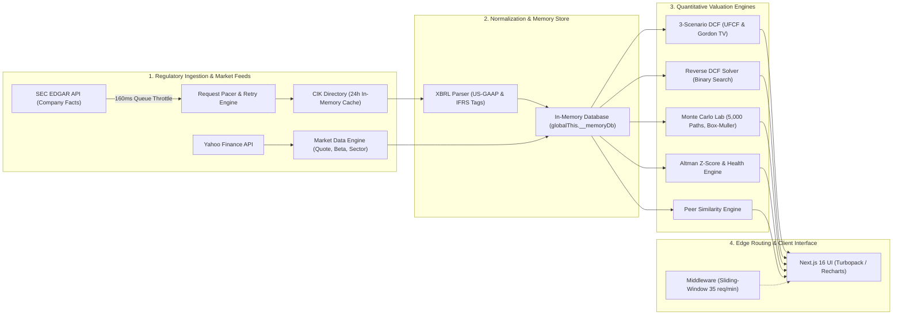

<div align="center">

# FinTracker

**Institutional Quantitative Equity Research and Automated Valuation Terminal**

[](https://nextjs.org/)
[](https://react.dev/)
[](https://tailwindcss.com/)
[](https://www.sec.gov/edgar)
[](LICENSE)

[Live Terminal](http://localhost:3000) &bull; [Sample NVDA Model](http://localhost:3000/company/NVDA) &bull; [Methodology](#quantitative-methodology)

</div>

---

## Preview


---

## Overview

Institutional equity analysis is bifurcated between expensive closed-source terminals (\$24k/year) and retail web screeners that obscure their DCF models behind opaque, uncalibrated target prices. FinTracker is an open-source valuation engine that extracts 15 years of raw SEC EDGAR XBRL filings, normalizes conflicting GAAP and IFRS disclosures, and executes fundamental Discounted Cash Flow models client-side in under 5 milliseconds. The system couples deterministic multi-scenario cash flow modeling with reverse-engineered market expectations and a 5,000-iteration Monte Carlo simulation suite, running decoupled from external database downtime.

---

## Core Quantitative Capabilities

* **Automated 3-Scenario DCF Modeling**: Generates 5-year Unlevered Free Cash Flow (UFCF) projections across Base, Bull, and Bear configurations. Projects sales trajectories from historical compound growth vectors, models NOPAT through operating margin scaling, and computes reinvestment requirements across Depreciation & Amortization (D&A), Capital Expenditures (CapEx), and Net Working Capital ($\Delta$NWC). Terminal Value is capitalized via the Gordon Growth Model and discounted using the Capital Asset Pricing Model (CAPM).
* **Reverse DCF Solver ("What Is The Market Pricing In?")**: Bypasses subjective forecasting by deploying a binary search numerical solver to invert the DCF formula against current equity pricing. Back-solves the exact 5-year revenue CAGR and operating margin hurdle rates required to equate model intrinsic value to $P_{\text{market}}$, pinpointing market optimism premiums or structural valuation discounts.
* **Probabilistic Monte Carlo Engine**: Stochastically models economic uncertainty through 5,000 growth iterations generated via the Box-Muller transform ($\sigma \in [2.0\%, 15.0\%]$). Computes empirical valuation probability density functions, 95% Value-at-Risk (VaR 95% downside floor), Expected Shortfall (CVaR tail expectation), Probability of Undervaluation, and a 45-path 5-year asset price trajectory fan with median convergence tracking.
* **Out-of-Sample Model Backtesting**: Assesses predictive validity by executing an isolated projection calibrated strictly on pre-2020 regulatory filings. Compares the simulated 2020 intrinsic target against realized equity prices and contrasts baseline forecast growth against actual 2020-2025 audited financial execution.
* **Credit & Financial Health Decomposition**: Evaluates corporate solvency using the 5-factor Altman Z-Score, categorized into Safe ($Z > 2.99$), Gray ($1.81 \le Z \le 2.99$), and Distress ($Z < 1.81$) zones. Breaks balance sheet health into sub-scores across Liquidity, Solvency, Financial Leverage, and Profitability, applying structural warnings for financial institutions where deposit liabilities distort working capital metrics.
* **Valuation Triangle & Peer Multiples**: Triangulates DCF intrinsic valuation against sector peer multiples (P/E, EV/EBIT, EV/Sales) and 10-year historical medians. Scores comparable firms using a quantitative similarity index based on logarithmic market capitalization distance and operating margin proximity.
* **2D Sensitivity Matrix**: Cross-analyzes fair value across a 5x4 matrix of Weighted Average Cost of Capital discount rates ($\text{WACC} \pm 1.0\%$) against perpetual terminal growth rates ($g \in [1.5\%, 3.0\%]$). Color-codes cells trading at a discount to market spot prices.

---

## System Architecture



### Engineering Highlights

* **Database Decoupling (<5ms Latency)**: Eliminates connection hangs caused by paused cloud database instances. Primary operations run on an in-memory storage layer (`globalThis.__memoryDb`) pre-seeded with S&P 500 financial histories, executing lookups in under 5ms. Optional PostgreSQL replication runs asynchronously with a 1-second timeout ceiling.
* **SEC EDGAR Regulatory Pipeline & Pacing Queue**: Queries raw SEC EDGAR JSON endpoints (`data.sec.gov`) covering up to 15 years of Form 10-K and Form 20-F filings. Resolves CIK identities in 0ms via a 24-hour cached directory. Outbound SEC requests pass through a FIFO pacing queue enforcing a minimum 160ms interval (~6.25 req/sec max) to maintain compliance with the SEC 10 req/sec threshold, backed by automated exponential backoff on HTTP 429 responses.
* **Dual GAAP & IFRS Normalization**: Dynamically reconciles accounting standard divergences. Parses domestic US-GAAP concepts (`RevenueFromContractWithCustomerExcludingAssessedTax`, `OperatingIncomeLoss`) and foreign private issuer IFRS disclosures (`Revenue`, `OperatingProfitLoss`) while normalizing multi-currency reports (`USD`, `EUR`, `GBP`).
* **Zero-Cost Market Data Integration**: Routes real-time equity spot prices, beta coefficients, sector groupings, and daily closing series through `yahoo-finance2`, eliminating reliance on restricted free-tier API quotas. An Alpha Vantage provider serves as a secondary fallback.
* **Edge Abuse Protection**: Next.js Edge Middleware enforces an in-memory sliding-window rate limiter restricting client IPs to 35 requests per minute across `/api/companies/*` and `/api/dcf`. Edge caching headers (`s-maxage=3600, stale-while-revalidate=86400`) cache immutable filing data across CDN nodes.
* **Data Provenance & Audit Banners**: An automated audit pass scans statement completeness. Verified filings render an `AUDITED STATEMENTS VERIFIED` badge; non-standard or missing regulatory tags trigger an amber `[CAUTION] PRESET ASSUMPTIONS ACTIVE` banner detailing missing fields with calibration shortcuts.

---

## Quantitative Methodology

<details>
<summary><strong>1. Unlevered Free Cash Flow (UFCF) and Enterprise Value</strong></summary>

Corporate cash distributions are projected over a 5-year discrete forecast horizon:

$$\text{NOPAT}_t = \text{EBIT}_t \times (1 - \tau)$$

$$\text{UFCF}_t = \text{NOPAT}_t + \text{D\&A}_t - \text{CapEx}_t - \Delta\text{NWC}_t$$

Where $\tau$ is the effective corporate tax rate, $\text{D\&A}$ is modeled at 3.0% of revenue, $\text{CapEx}$ at 4.0% of revenue, and $\Delta\text{NWC}$ at 5.0% of annual working capital baselines.

The perpetual Terminal Value ($TV_5$) is determined via the Gordon Growth Model:

$$TV_5 = \frac{\text{UFCF}_5 \times (1 + g)}{\text{WACC} - g}$$

Where $g$ is the long-run perpetual growth rate (constrained to $g < \text{WACC}$). Enterprise Value (EV) and Equity Value Per Share are calculated as:

$$\text{Enterprise Value (EV)} = \sum_{t=1}^{5} \frac{\text{UFCF}_t}{(1 + \text{WACC})^t} + \frac{TV_5}{(1 + \text{WACC})^5}$$

$$\text{Intrinsic Fair Value Per Share} = \frac{\text{EV} - \text{Total Debt} + \text{Cash}}{\text{Diluted Shares Outstanding}}$$

The Weighted Average Cost of Capital (WACC) is established using the Capital Asset Pricing Model (CAPM):

$$\text{Cost of Equity } (K_e) = R_f + \beta \times \text{ERP}$$

$$\text{WACC} = \left( \frac{E}{V} \times K_e \right) + \left( \frac{D}{V} \times K_d \times (1 - \tau) \right)$$

</details>

<details>
<summary><strong>2. Reverse DCF Binary Search Solver</strong></summary>

Given observed market equity valuation $P_{\text{market}}$, the system solves for the implied operational vector $\mathbf{\theta}^* = (g^*, m^*)$ such that:

$$\left| f_{\text{DCF}}(\mathbf{\theta}^*) - P_{\text{market}} \right| < \epsilon, \quad \epsilon = 10^{-4}$$

The binary search algorithm evaluates bounds over a 40-iteration halving sequence:

$$g^{(k+1)} = \frac{g_{\text{low}}^{(k)} + g_{\text{high}}^{(k)}}{2}, \quad g \in [-0.30, 0.80]$$

$$m^{(k+1)} = \frac{m_{\text{low}}^{(k)} + m_{\text{high}}^{(k)}}{2}, \quad m \in [0.01, 0.90]$$

If $f_{\text{DCF}}(g^{(k)}) < P_{\text{market}}$, then $g_{\text{low}}^{(k+1)} = g^{(k)}$; else $g_{\text{high}}^{(k+1)} = g^{(k)}$. The solver isolates implied revenue growth and operating margin in under 40 iterations.

</details>

<details>
<summary><strong>3. Box-Muller Transform (Monte Carlo Growth Permutations)</strong></summary>

Random growth deviations are generated using the Box-Muller transformation of independent uniform variates $U_1, U_2 \sim \text{Uniform}(0, 1)$:

$$Z_0 = \sqrt{-2 \ln U_1} \cos(2\pi U_2)$$

$$g_{\text{sim}, t} = \mu_{\text{hist}} + \sigma \cdot Z_0, \quad \sigma \in [0.02, 0.15]$$

Across $N = 5,000$ simulation trials, simulated equity prices $\{P_i\}_{i=1}^{N}$ are sorted in ascending order to establish the empirical cumulative distribution function:

$$\text{VaR}_{0.95} = P_{\lfloor 0.05 N \rfloor}$$

$$\text{CVaR}_{0.95} = \frac{1}{\lfloor 0.05 N \rfloor} \sum_{i=1}^{\lfloor 0.05 N \rfloor} P_i$$

$$\text{Prob. Undervalued} = \frac{1}{N} \sum_{i=1}^{N} \mathbb{I}(P_i > P_{\text{market}}) \times 100\%$$

</details>

<details>
<summary><strong>4. Altman Z-Score Formulation</strong></summary>

Corporate solvency is assessed across five standardized balance sheet ratios:

$$Z = 1.2 X_1 + 1.4 X_2 + 3.3 X_3 + 0.6 X_4 + 0.999 X_5$$

$$\begin{aligned}
X_1 &= \frac{\text{Working Capital}}{\text{Total Assets}} & X_2 &= \frac{\text{Retained Earnings}}{\text{Total Assets}} \\
X_3 &= \frac{\text{EBIT}}{\text{Total Assets}} & X_4 &= \frac{\text{Market Value of Equity}}{\text{Total Liabilities}} \\
X_5 &= \frac{\text{Sales}}{\text{Total Assets}}
\end{aligned}$$

Threshold criteria:
* $Z > 2.99 \implies \text{Safe Zone}$ (Low default probability)
* $1.81 \le Z \le 2.99 \implies \text{Gray Zone}$ (Moderate credit risk)
* $Z < 1.81 \implies \text{Distress Zone}$ (High probability of balance sheet restructuring)

</details>

---

## Local Development

### Prerequisites

* Node.js 18.18.0 or newer (Node.js 20+ LTS recommended)
* npm 9+ or pnpm 8+

### Setup

1. **Clone the repository**:
   ```bash
   git clone https://github.com/DevanshLath/FinTracker.git
   cd FinTracker/equity-research
   ```

2. **Install dependencies**:
   ```bash
   npm install
   ```

3. **Configure Environment Variables**:
   Create a `.env.local` file in `equity-research/`:
   ```bash
   # Required by SEC EDGAR: Format as 'OrganizationName contact@domain.com'
   SEC_USER_AGENT=FinTrackerResearch research@fintracker.dev

   # Optional fallback provider key (free tier at alphavantage.co)
   ALPHA_VANTAGE_API_KEY=demo

   # Optional PostgreSQL connection (defaults to in-memory store if omitted)
   DATABASE_URL=
   ```

4. **Launch Development Server (Turbopack)**:
   ```bash
   npm run dev
   ```

5. **Access Terminal**:
   Open `http://localhost:3000` in a browser.

### Production Build

```bash
npm run build
npm run start
```

---

## Disclaimer

FinTracker is software engineered strictly for quantitative financial research, computational economics, and academic evaluation. Output calculations, intrinsic valuations, and simulation parameters do not constitute financial advice, securities endorsements, or investment recommendations.
